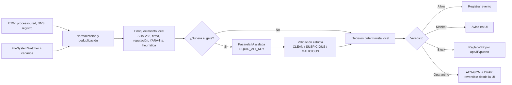

# Cómo funciona Aegis Guard

Aegis Guard es una **vertical slice funcional** de EDR/XDR para Windows. No promete protección absoluta: combina evidencia local verificable con un clasificador cloud probabilístico que **nunca decide por sí solo** bloquear ni poner en cuarentena.

La idea central es: **observar → normalizar → enriquecer → decidir → remediar**, sin escaneos continuos.

## Flujo completo

## 1. Captura de eventos

El servicio (`Aegis.Service`) mantiene:

- **ETW en tiempo real** de los providers de proceso, red, DNS y registro. No se hacen escaneos periódicos de disco.
- **FileSystemWatcher** sobre directorios de interés, filtrando extensiones ejecutables y documentos con macros.
- **Canarios anti-ransomware**: ficheros señuelo cuyo cambio dispara una observación de alta severidad.
- **Snapshot de procesos** como respaldo cuando ETW no está disponible.

Dos detalles aprendidos en pruebas reales:

- Los campos `daddr`/`saddr` de ETW de red llegan como `Int32` **little-endian**. `16777343` es `127.0.0.1`, no `1.0.0.127`. La conversión vive en `Aegis.Core/TelemetryUtils.cs` y tiene pruebas.
- Una conexión establecida genera miles de eventos por minuto. `EventDeduplicator` conserva un único registro por destino cada 10 segundos. En el equipo de desarrollo esto bajó de ~2470 eventos/6 s a ~18 eventos/12 s.

## 2. Enriquecimiento local

Cada observación se enriquece con señales que no salen del equipo:

| Señal | Qué aporta |
| --- | --- |
| SHA-256 | Identidad del fichero y comparación con listas locales. |
| Firma Authenticode | Distingue firmado de confianza, firmado no válido y sin firma. |
| Reputación local | Prioridad según origen y frecuencia observada. |
| YARA-lite | Subconjunto de YARA: cadenas, hexadecimal con `??`, `nocase`/`wide` y `severity`. |
| Heurística | Banderas de comportamiento: persistencia, inyección, manipulación de seguridad, canario modificado. |

`Aegis.Core` contiene estas primitivas; `DetectionPipeline` orquesta el flujo.

## 3. Cuándo se consulta a la IA

Para evitar coste y exposición innecesaria, **solo se envían** eventos que cumplen alguna de estas condiciones:

- `score >= 20`,
- tienen banderas de comportamiento,
- son un análisis manual (`ManualScan`),
- son un cambio de persistencia (`PersistenceChanged`).

El tráfico banal (DNS repetitivo, conexiones normales) se decide en local. La petición se minimiza: no se envía contenido de ficheros, rutas completas ni telemetría sin relación con la decisión.

## 4. Pasarela IA y separación de claves

`Aegis.CloudGateway` es el **único** componente que conoce `LIQUID_API_KEY`:

- Normaliza la clave anteponiendo `liquid` si el usuario la copió sin prefijo.
- Llama a `POST https://api.liquid.ai/decisions/v1/systemone` con el modelo `d1.2-ultra` (o `d1.2`).
- Valida la respuesta: etiqueta `CLEAN`/`SUSPICIOUS`/`MALICIOUS`, distribución de probabilidades severidad y `requestId`. Una respuesta inválida se descarta.
- Ante `429`/`503`, respeta `Retry-After`, abre una ventana de supresión y devuelve `limitado por Liquid`.

El cliente Windows (`LiquidGatewayClient`) solo conoce `AEGIS_GATEWAY_KEY`, una clave aleatoria local. Añade caché de 15 minutos, circuit breaker y mapeo de `rate-limited`. Si la nube falla, el motor local sigue decidiendo.

## 5. Decisión determinista

`DecisionEngine`combina la evidencia local con la ponderación de IA (`aiWeight`, por defecto `0.3`) y aplica umbrales configurables:

| Veredicto | Umbral por defecto | Acción |
| --- | --- | --- |
| `Allow` | < 25 | Se registra el evento. |
| `Monitor` | ≥ 25 | Aviso en la UI, sin bloqueo. |
| `Block` | ≥ 58 | Regla WFP para la aplicación/IP/puerto. |
| `Quarantine` | ≥ 80 | Fichero cifrado y retirado, reversible. |

La IA **nunca** puede producir `Block` o `Quarantine` por sí sola: solo ajusta riesgo y confianza dentro de una decisión determinista.

## 6. Remediación

- **Firewall WFP:** usa COM `HNetCfg.FwPolicy2` para crear reglas con prefijo `AEGIS Guard`, auditables y eliminables. No hay driver de callout: no inspecciona tráfico en tiempo real ni bloquea conexiones anteriores a la regla.
- **Cuarentena:** AES-GCM con clave protegida por DPAPI. El fichero se puede restaurar desde la UI; el purgado definitivo es explícito.
- **Modo aprendizaje:** las conexiones nuevas se observan antes de bloquearse.

## 7. Interfaz y API

La UI es una SPA servida por el propio servicio y mostrada en WebView2 (`Aegis.UI`). El token local se genera en `%AEGIS_DATA_DIR%\ui-token` (por defecto `C:\ProgramData\AegisGuard\ui-token`) y se inyecta en la página como `window.AEGIS_TOKEN`; nunca viaja a la nube. Todas las rutas `/api` exigen `Bearer` y solo escuchan en `127.0.0.1`; `/healthz` es público y no expone estado.

Los datos mostrados son reales: no hay valores de ejemplo ni controles decorativos.

## Qué no hace

- No sustituye ni desactiva Bitdefender u otros productos de seguridad.
- No tiene driver kernel: sin callbacks de inyección, sin sandbox y sin antimanipulación a nivel kernel.
- No promete detección absoluta; los umbrales están pendientes de calibrar con datos propios.
- No realiza escaneos completos periódicos.

La RAM observada en el servicio es de ~116–166 MB, por encima del objetivo inicial de 100 MB; está documentado como desviación conocida.
