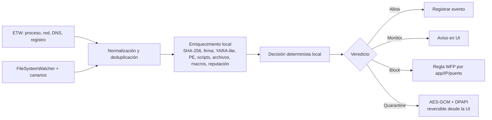

# Cómo funciona Aegis Guard

Aegis Guard es una **vertical slice funcional** de antivirus y cortafuegos local para Windows. No promete protección absoluta: todas las decisiones se toman en el equipo con evidencia verificable, sin servicios remotos ni consultas externas.

La idea central es: **observar → normalizar → enriquecer → decidir → remediar**, sin escaneos continuos.

## Flujo completo

## 1. Captura de eventos

El servicio (`Aegis.Service`) mantiene:

- **ETW en tiempo real** de los providers de proceso, red, DNS y registro. No se hacen escaneos periódicos de disco.
- **FileSystemWatcher** sobre directorios de interés, filtrando extensiones ejecutables y documentos con macros.
- **Canarios anti-ransomware**: ficheros señuelo cuyo cambio dispara una observación de alta severidad.
- **Snapshot de procesos** como respaldo cuando ETW no está disponible.

Dos detalles aprendidos en pruebas reales:

- Los campos `daddr`/`saddr` de ETW de red llegan como `Int32` **little-endian**. `16777343` es `127.0.0.1`, no `1.0.0.127`. La conversión vive en `Aegis.Core/TelemetryUtils.cs` y tiene pruebas.
- Una conexión establecida genera miles de eventos por minuto. `EventDeduplicator` conserva un único registro por destino cada 10 segundos. En el equipo de desarrollo esto bajó de ~2470 eventos/6 s a ~18 eventos/12 s.
- `PriorityObservationQueue` añade dos colas: las alertas críticas se drenan primero, los duplicados se coalescionan y los descartes se contabilizan. Si se pierde visibilidad, el estado pasa a `degraded` y se genera una alerta; un watcher en error se recrea.

## 2. Enriquecimiento local

Cada observación se enriquece con señales que no salen del equipo:

| Señal | Qué aporta |
| --- | --- |
| SHA-256 | Identidad del fichero y comparación con listas locales. |
| Firma Authenticode | Distingue `SignedTrusted`, `SignedUntrusted`, `Unsigned`, `ChainNotVerifiable` y `Unknown`. Usa ciclo WinTrust completo con cierre del handle y solo caché local de revocación; una firma válida no certifica inocuidad. |
| Reputación local | Historial persistido en `reputation.json` con checksum; dos decisiones adversarias se necesitan para bajarla a 0,1. Sin consultas remotas. |
| YARA-lite | Subconjunto de YARA: cadenas, hexadecimal con `??`, `nocase`/`wide` y `severity`. |
| PE | Cabeceras y secciones: W+X, punto de entrada, importaciones, hardening y overlay. Una cabecera rota es análisis incompleto, no malware. |
| Scripts | UTF-8/UTF-16, Base64 observable y correlación de codificación, `IEX`, ejecución externa, descarga y ofuscación. Una sola cadena no bloquea. |
| Comprimidos | ZIP/JAR, GZIP y TAR en memoria con topes declarados antes de descomprimir, miembros ejecutables y anidamiento limitado. Nada se extrae a disco. |
| Macros | `vbaProject.bin` en OOXML y streams VBA legibles en OLE/CFB; autoarranque + ejecución externa. El texto visible del documento no puntúa. |
| Heurística | Banderas realmente producidas por el monitor: persistencia en registro, modificación de canarios, manifiesto de canarios alterado, beacon C2, ejecución desde `%TEMP%`, padre inusual (Office), renombrado, reutilización de PID y saturación de cola. |

Las banderas que el monitor no produce se ignoran: no puntúan capacidades no implementadas. `Aegis.Core` contiene estas primitivas; `DetectionPipeline` orquesta el flujo. No existe telemetría saliente: las observaciones solo se escriben en `events.jsonl` / `threats.jsonl`.

Las reglas pueden venir del juego incluido con el binario o de un paquete local firmado: el manifiesto se verifica con ECDSA P-256, la clave pública se fija mediante `AEGIS_INTEL_KEY_SHA256` y cada fichero se comprueba por SHA-256 antes de cargarse. Si algo cambia, no se carga nada del paquete y `/api/status` indica `rejected:<motivo>`. No hay descarga ni decisión remota.

Cada evidencia lleva un `RuleId`, un analizador y una cadena verificable. Por ejemplo, una sección ejecutable y escribible aparece en las razones como `pe: PE-WRITABLE-EXECUTABLE-SECTION: … [.text (0xE0000020)] (+22)`. Al terminar el análisis se recalcula el hash para detectar que el fichero cambió mientras se inspeccionaba. Los contenedores cifrados o no interpretables se muestran como no verificados, no como limpios.

## 3. Decisión determinista local

`DecisionEngine` usa únicamente la evidencia local. El riesgo es el score de `LocalAssessment` (hash, reglas, firma, reputación, banderas e IP pública), sin ponderaciones externas:

| Veredicto | Umbral por defecto | Acción |
| --- | --- | --- |
| `Allow` | < 25 | Se registra el evento. |
| `Monitor` | ≥ 25 | Aviso en la UI, sin bloqueo. |
| `Block` | ≥ 58 | Regla WFP para la aplicación/IP/puerto. |
| `Quarantine` | ≥ 80 | Fichero cifrado y retirado, reversible. |

Un indicador crítico local en un fichero (hash en lista de denegación o regla crítica) fuerza cuarentena; si la cuarentena está desactivada, degrada a bloqueo en lugar de permitir la amenaza. Las reglas duplicadas se cuentan una sola vez para no inflar el riesgo. Los umbrales se validan para permanecer ordenados por debajo de 100.

En modo aprendizaje las decisiones se registran, pero no se aplican cuarentena ni bloqueo WFP automáticos. Los indicios verificados localmente (hash en lista de denegación o regla EICAR) se siguen aplicando para no desarmar la protección básica.

## 4. Remediación

- **Firewall WFP:** usa COM `HNetCfg.FwPolicy2` para crear reglas con prefijo `AEGIS Guard`, auditables y eliminables. `GET /api/firewall/stats` distingue reglas automáticas (creadas por un hallazgo) de manuales; el panel muestra el total de reglas activas, no un recuento de paquetes bloqueados. No hay driver de callout: no inspecciona tráfico en tiempo real ni bloquea conexiones anteriores a la regla.
- **Cuarentena:** AES-GCM con clave protegida por DPAPI. El fichero se puede restaurar desde la UI; el purgado definitivo es explícito.
- **Modo aprendizaje:** registra las conexiones nuevas en `/api/firewall/learned` para revisión y omite la remediación automática, salvo indicios verificados.

## 5. Interfaz y API

La UI es una SPA servida por el propio servicio y mostrada en WebView2 (`Aegis.UI`). No hay token local ni credenciales inyectadas en la página: las rutas `/api` solo sirven lecturas y análisis en `127.0.0.1`, y `/healthz` es público. Para restaurar/purgar cuarentena, gestionar reglas o cambiar la política, WebView2 llama al objeto nativo `aegis`, que solicita elevación UAC y habla con el servicio por Named Pipe. El servicio verifica el PID, el SID, la integridad y el tipo de elevación del proceso cliente antes de actuar, y registra cada intento.

Los datos mostrados son reales: no hay valores de ejemplo ni controles decorativos.

## 6. Qué no hace

- No sustituye ni desactiva Microsoft Defender, Bitdefender u otros productos de seguridad.
- No tiene driver kernel: sin callbacks de inyección, sin sandbox y sin antimanipulación a nivel kernel.
- Todo se procesa en el equipo: no hay consultas a servidores ni descargas; funciona sin Internet.
- No descarga firmas: las reglas se entregan con el producto y se editan localmente.
- No promete detección absoluta; los umbrales están pendientes de calibrar con datos propios.
- No realiza escaneos completos periódicos.

La medición histórica del lote 2 (2026-11-24) dio 77,2 MB de RAM media y 0,05 % de CPU media (máximos puntuales: 78,6 MB y 1 %). La referencia vigente es la de Fase 6 en Release: 84,47 MB de RAM media del servicio, 0,3 % de CPU media y `droppedEvents=0`. El procedimiento y el resto de métricas están en [benchmarks](BENCHMARKS.md).
